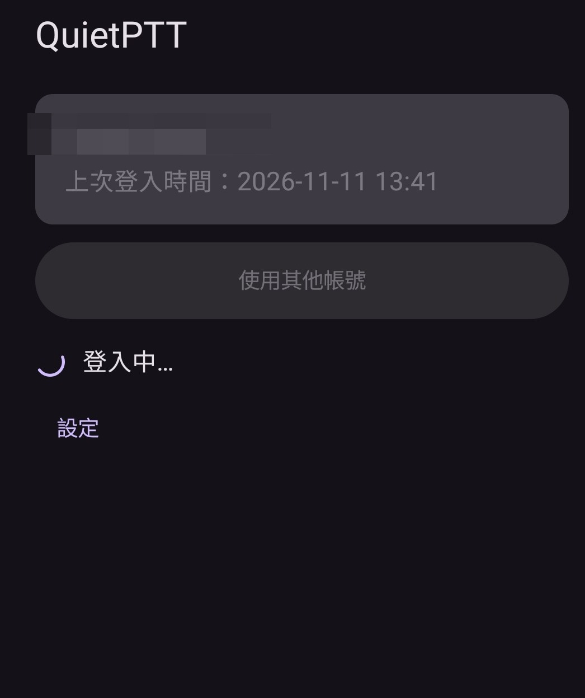
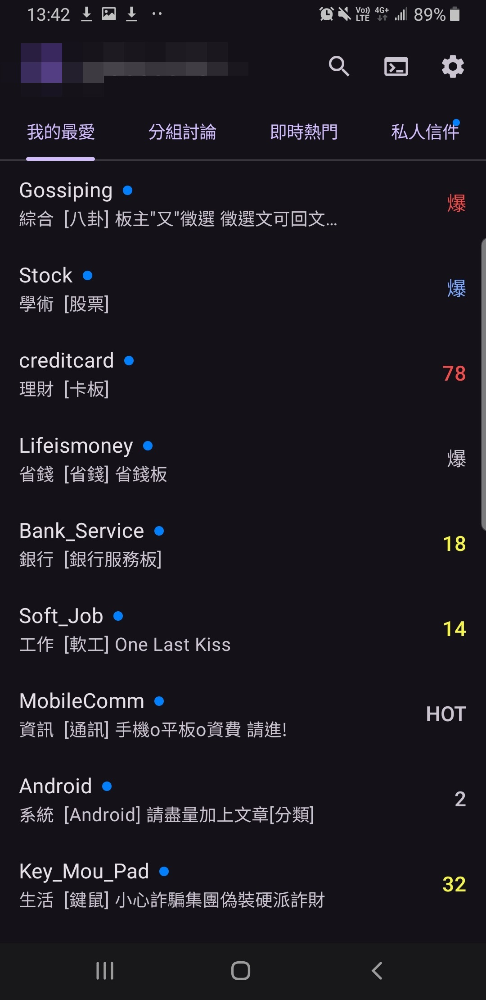
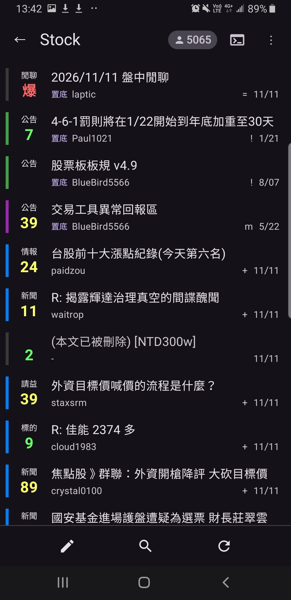
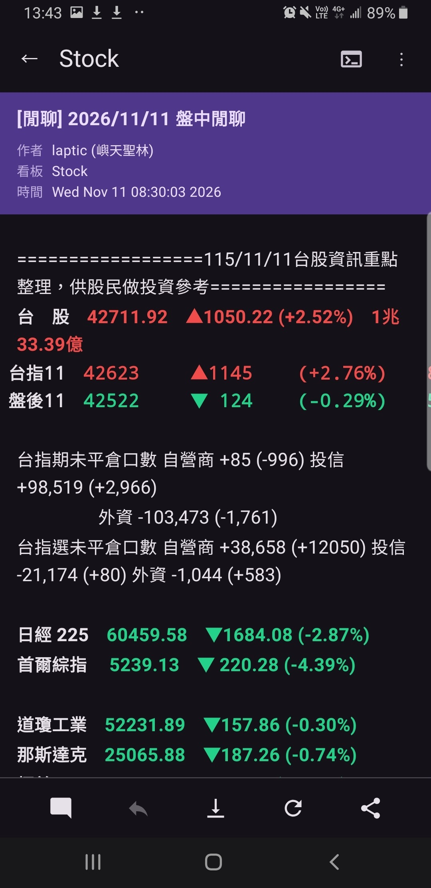
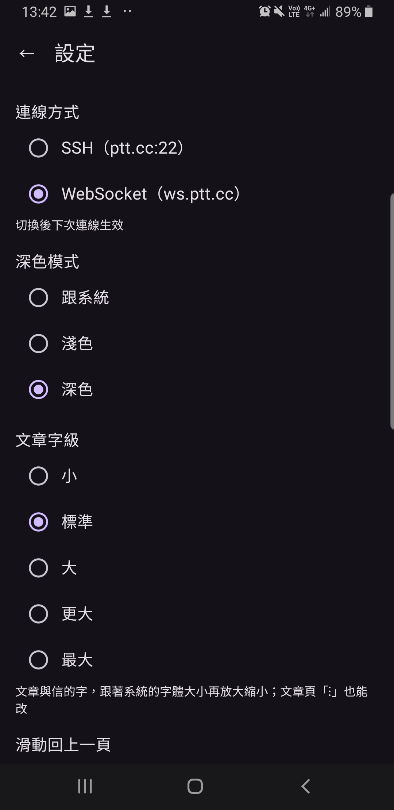
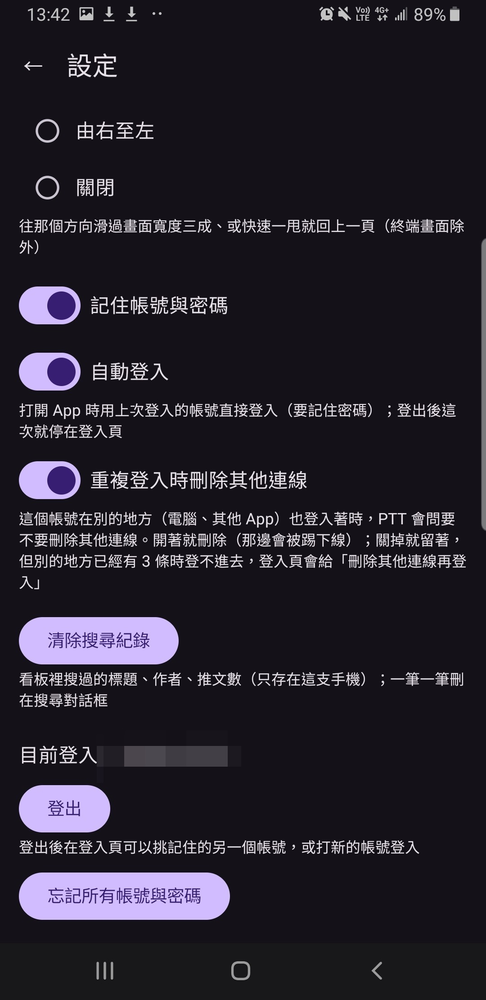
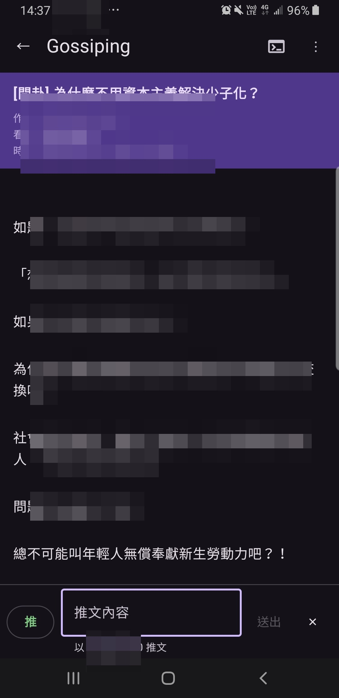
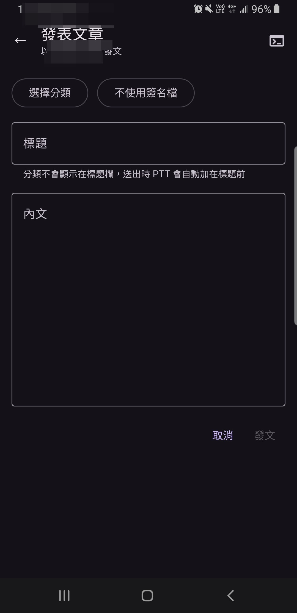
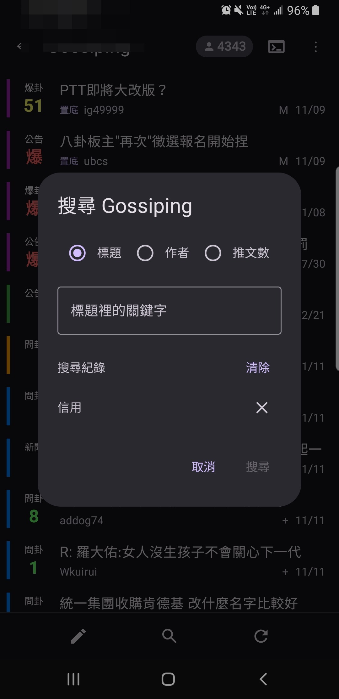
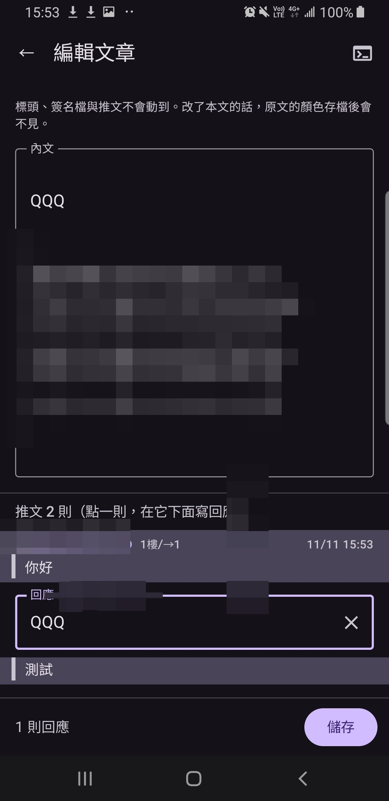

# QuietPTT

安靜的 PTT Android 客戶端。

- **沒有廣告、沒有遙測**：沒有任何第三方 SDK，對外只連 `ptt.cc`；文章裡的圖片按了「開啟圖片」才抓那一張
- **不在背景做事**：只在前景連線，退到背景 2 分鐘就斷線；沒有前景服務、沒有常駐、沒有查信
- **只要一個權限**：網路
- **兩種連線**：SSH（預設）或 WebSocket，設定裡切換
- **記住帳號與密碼**（可關）：密碼用手機的 KeyStore 加密，不會被備份出去

支援 Android 9 以上。

## 功能

我的最愛、分組討論、即時熱門、看板（搜尋、重整）、文章（推文、回文、複製全文、分享）、發文、改刪自己的文章、站內信（讀信、寄信、回信）、找看板、加入我的最愛、多帳號。
認不出來的畫面退到終端畫面，直接按鍵操作。每個功能怎麼運作見 [`docs/spec.md`](docs/spec.md)。

## 畫面

| 登入 | 我的最愛 | 看板 |
| :---: | :---: | :---: |
|  |  |  |
| **文章** | **設定** | **設定（續）** |
|  |  |  |
| **推文** | **發文** | **搜尋** |
|  |  |  |
| **編輯文章** | | |
|  | | |

## 下載

[下載 `quietptt.apk`](../../releases/latest/download/quietptt.apk)（[GitHub Release](../../releases/latest)）。不上架 Google Play。

## 開發

Kotlin + Jetpack Compose，在 [claude.ai/code](https://claude.ai/code) 雲端 session 開發。
不碰 Android 的部分（連線、終端模擬、Big5-UAO、畫面辨識）是純 Kotlin 的 `core` module，用 JVM 單元測試；
畫面的測試在 GitHub Actions 的 Android 9 模擬器上跑並錄影（[`record.yml`](.github/workflows/record.yml)）。

- 規格：[`docs/spec.md`](docs/spec.md)
- 架構、約定：[`CLAUDE.md`](CLAUDE.md)
- 測試、錄影、抓畫面：[`docs/testing.md`](docs/testing.md)
- 雲端環境設定：[`docs/cloud-setup.md`](docs/cloud-setup.md)
- 發版金鑰：[`docs/release-key.md`](docs/release-key.md)
- debug 版與 release 版差在哪：[`docs/debug-vs-release.md`](docs/debug-vs-release.md)
- 之後可能會做：[`docs/ideas.md`](docs/ideas.md)

## Donation

文章都是我自己研究內化後原創，如果有幫助到您，也想鼓勵我的話，歡迎請我喝一杯咖啡 :laughing:

綠界科技ECPAY ( 不需註冊會員 )

[贊助者付款](http://bit.ly/2F7Jrha)

歐付寶 ( 需註冊會員 )

[贊助者付款](https://payment.opay.tw/Broadcaster/Donate/9E47FDEF85ABE383A0F5FC6A218606F8)

## 贊助名單

[贊助名單](https://github.com/twtrubiks/Thank-you-for-donate)
